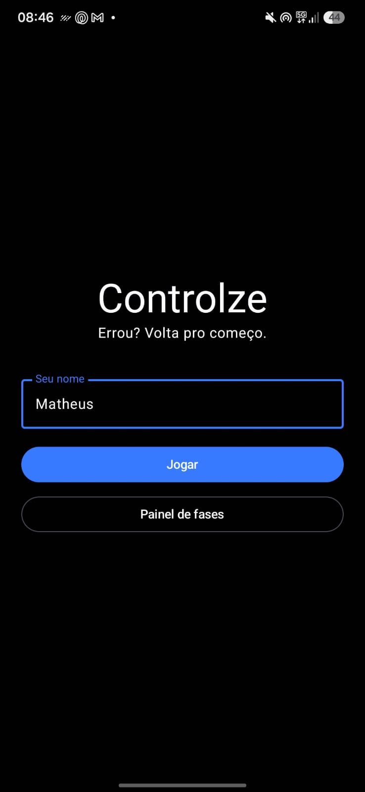
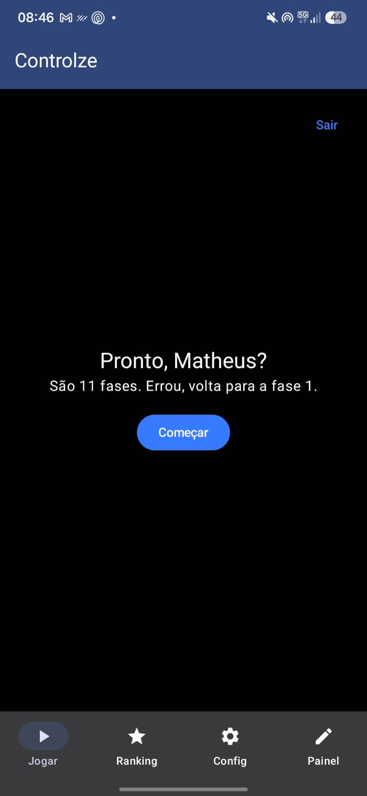
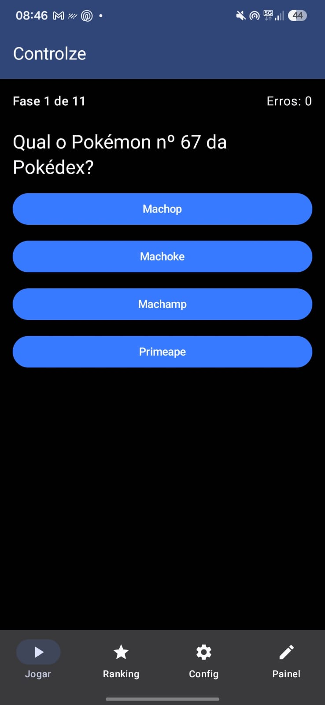
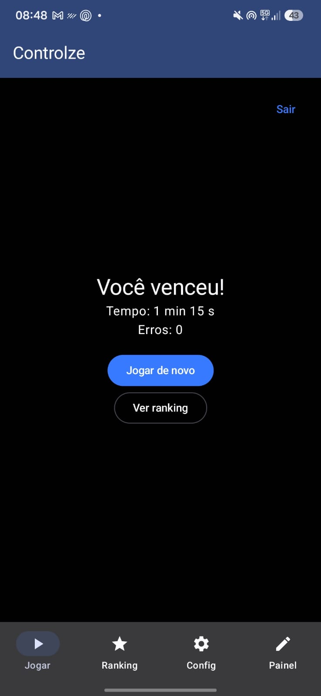
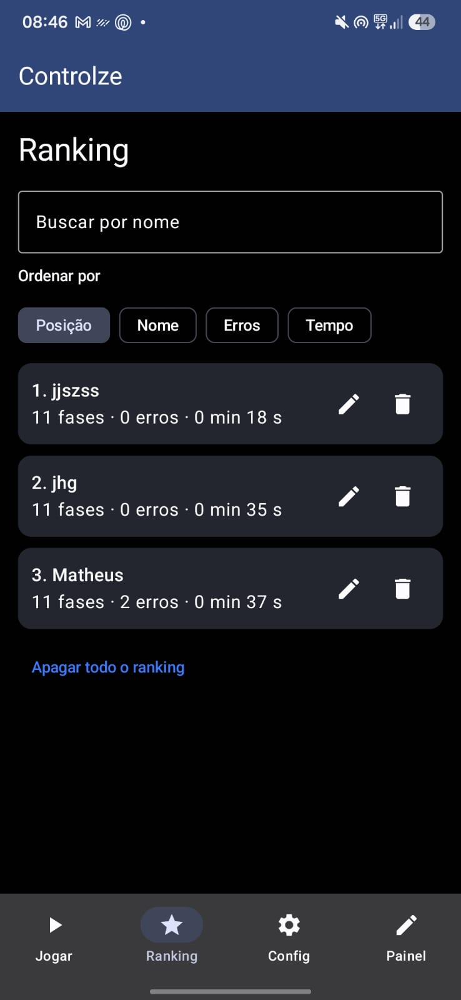
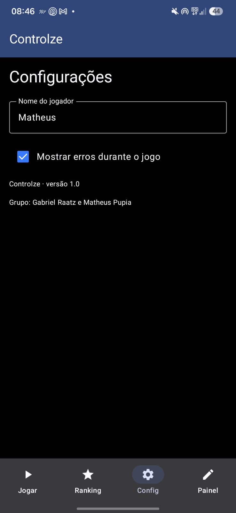
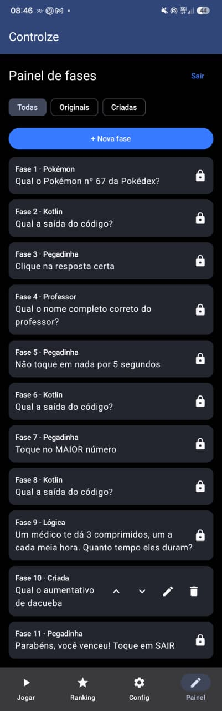
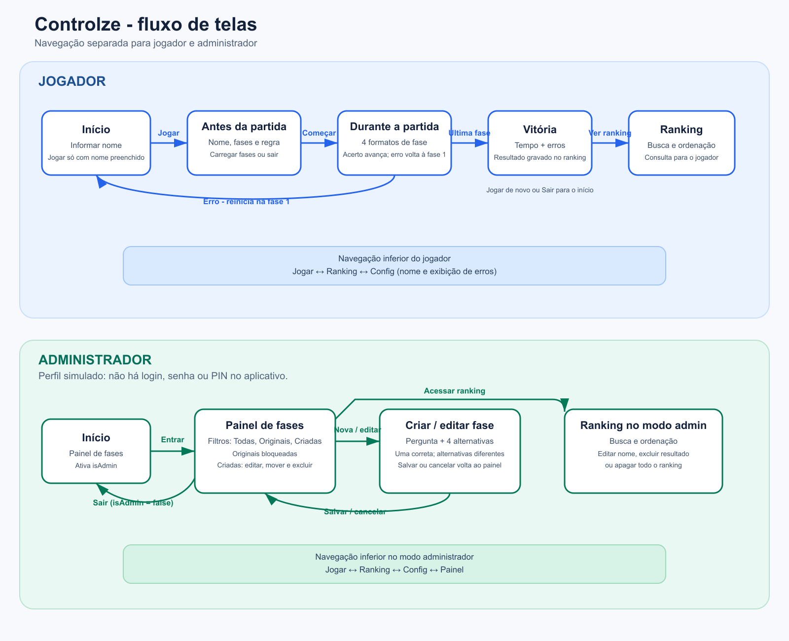

# Controlze

**Controlze** é um mini-jogo Android de perguntas com pegadinhas. A regra principal é simples: ao errar uma fase, o jogador volta para a fase 1. O aplicativo combina uma experiência de jogo com ranking, configurações e um painel administrativo para gerenciar fases criadas.

## Integrantes

- Gabriel Raatz
- Matheus Pupia

## Vídeo de demonstração

[▶ Assistir à demonstração do Controlze no YouTube](https://www.youtube.com/shorts/zjwJlbJAw24)

## Capturas de tela

| Início | Antes da partida | Durante a partida |
| --- | --- | --- |
|  |  |  |
| Nome do jogador, acesso ao jogo e ao painel. | Nome, quantidade de fases, regra do jogo e botão para começar. | Questão de múltipla escolha e contador de erros. |

| Vitória | Ranking no modo administrador | Configurações |
| --- | --- | --- |
|  |  |  |
| Tempo, erros, nova partida, ranking e saída. | Busca, ordenação e ações administrativas. | Nome do jogador e exibição de erros. |

| Painel de fases |
| --- |
|  |
| Filtros de fases, originais bloqueadas e ações nas fases criadas. |

## Como funciona

### Fluxo do jogador

1. **Início:** o jogador informa o nome. O botão **Jogar** só é liberado quando o campo não está vazio.
2. **Antes da partida:** a tela apresenta o nome, a quantidade de fases e a regra de que um erro reinicia a partida. Se ainda não houver fases disponíveis, é possível usar **Carregar fases originais**. O botão **Sair** retorna ao início.
3. **Durante a partida:** as fases seguem a ordem cadastrada. Há quatro formatos: múltipla escolha, tocar uma palavra, escolher o número destacado e esperar cinco segundos sem tocar na tela. Cada acerto avança; cada erro soma um erro e volta à fase 1.
4. **Vitória:** ao concluir a última fase, o app calcula o tempo total, registra o resultado no ranking e oferece **Jogar de novo**, **Ver ranking** e **Sair**.
5. **Ranking e configurações:** pelo menu inferior, o jogador pode consultar o ranking, buscar por nome e ordenar por posição, nome, erros ou tempo. Em **Config**, pode alterar o nome e escolher se o contador de erros aparece durante o jogo. No modo jogador, o ranking não exibe ações de editar ou excluir.

### Fluxo do administrador

1. **Entrada no painel:** na tela inicial, o botão **Painel de fases** ativa o estado de administrador e abre o painel. É uma simulação de perfil para o trabalho: não há login, senha ou PIN.
2. **Painel de fases:** permite filtrar por **Todas**, **Originais** ou **Criadas**. Fases originais ficam bloqueadas. Nas criadas, o administrador pode editar, excluir e, no filtro **Todas**, mover a fase para cima ou para baixo. A exclusão pede confirmação.
3. **Criar ou editar fase:** o formulário pede uma pergunta, quatro alternativas e uma resposta correta. Para salvar, a pergunta deve estar preenchida, as quatro alternativas devem ser preenchidas e diferentes, e uma delas precisa estar marcada como correta. As fases criadas são de múltipla escolha.
4. **Ranking administrativo:** além de buscar e ordenar, o administrador pode editar o nome de um resultado, excluir um resultado ou apagar todo o ranking. As exclusões pedem confirmação.

## Diagrama de telas



## Funcionalidades

- Fases originais e fases personalizadas criadas pelo administrador.
- Quatro tipos de fase: múltipla escolha, tocar uma palavra, número gigante e esperar cinco segundos sem tocar.
- Regra de erro: soma um erro e reinicia a partida na primeira fase.
- Ranking com busca e ordenação por posição, nome, erros ou tempo.
- CRUD completo do ranking no modo administrador.
- Painel com filtro, criação, edição, movimentação e exclusão de fases criadas.
- Proteção de fases originais contra edição, movimentação e exclusão.
- Configurações de nome do jogador e visualização de erros durante a partida.
- Funcionamento offline para fases que já foram carregadas no armazenamento local.

## Arquitetura e dados

O projeto segue **MVVM** e mantém a interface separada das regras e das fontes de dados:

```text
Telas Compose
    ↓
ViewModels (estado e regras de negócio)
    ↓
Repositories
    ├── Room (dados locais e reativos)
    └── Firebase Cloud Firestore (fases remotas)
```

- `GameViewModel`, `RankingViewModel`, `AdminViewModel` e `SessaoViewModel` controlam estados independentes da interface.
- `AppViewModelFactory` injeta os repositories nos ViewModels, evitando que as telas criem banco ou Firebase diretamente.
- O Room possui duas entidades: `FaseEntity` e `RankingEntity`. Os DAOs expõem listas por `Flow`, atualizando a interface quando os dados mudam.
- O Firestore sincroniza apenas as **fases**. O **ranking** permanece local no Room.
- `FaseRepository` trata falhas de banco e sincronização; sem conexão, o app usa as fases já salvas no aparelho.
- A busca e a ordenação do ranking são aplicadas no ViewModel com funções de coleção Kotlin, como `filter` e comparadores de ordenação.

## Tecnologias

- Kotlin
- Jetpack Compose e Material 3
- Navigation Compose e ViewModel
- Room 3 e KSP
- Firebase Cloud Firestore
- Coroutines
- Android 7.0 ou superior (API 24+)
- Java 11

## Como executar

1. Clone o repositório:

   ```bash
   git clone https://github.com/psuehtam/Controlze.git
   ```

2. Abra a pasta clonada no Android Studio.
3. Confirme que `app/google-services.json` está presente.
4. Faça a sincronização do Gradle.
5. Execute a configuração `app` em um emulador ou aparelho com Android 7.0 (API 24) ou superior.
6. Na primeira execução, informe um nome, toque em **Jogar** e, se necessário, use **Carregar fases originais**.

## Testes

Para executar os testes unitários no Windows:

```powershell
.\gradlew.bat test
```

Os testes cobrem regras do jogo e das pegadinhas, filtro e ordenação do ranking, validação e movimentação de fases, sessão e conversões entre modelos locais e remotos.

## Estrutura do projeto

```text
app/src/main/java/com/grupo/controlze/
├── data/
│   ├── local/        # Room: entidades, DAOs e banco
│   ├── remote/       # Firestore: DTOs e fonte remota
│   └── repository/   # Ponte entre ViewModels, Room e Firestore
├── logic/            # modelos, fases originais e regras de negócio
└── ui/               # telas Compose, ViewModels, navegação e tema
```
