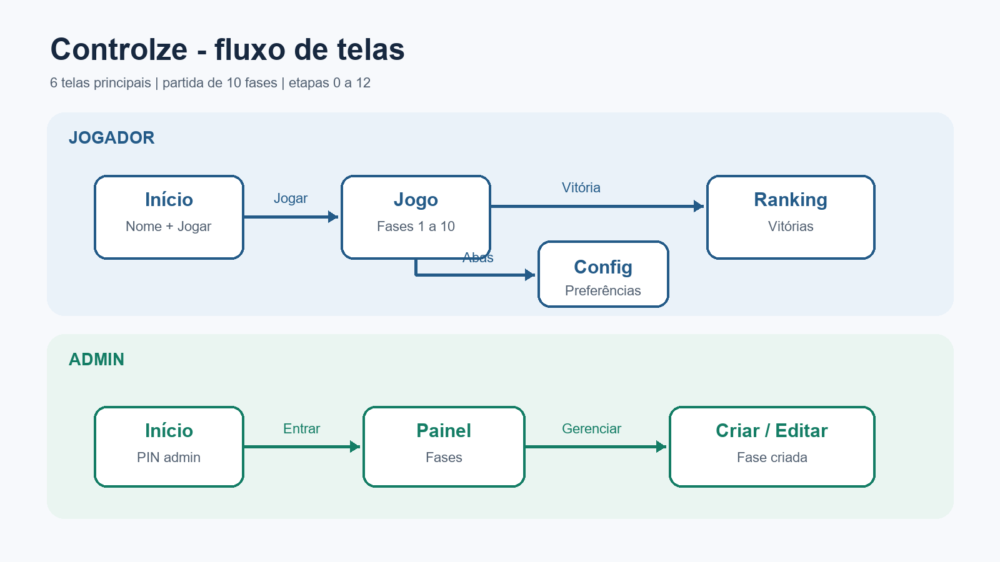

# Controlze

Aplicativo Android de perguntas com pegadinhas: ao errar uma fase, o jogador retorna ao início da partida. As fases ficam salvas no aparelho e podem ser sincronizadas com o Firebase.

## Integrantes

- Gabriel Raatz
- Matheus Pupia

## Funcionalidades

- Dez fases originais, incluindo as pegadinhas de tocar palavra, número gigante e esperar sem tocar.
- Ranking com busca, ordenação, edição de nome e exclusão de resultados.
- Painel para criar, editar, mover e excluir somente fases personalizadas.
- Fases originais protegidas contra edição, movimentação e exclusão.
- Sincronização de fases com o Cloud Firestore e persistência local com Room.
- Configuração do nome do jogador e da exibição do contador de erros.

## Como executar

1. Clone o repositório e abra a pasta no Android Studio.
2. Confirme que `app/google-services.json` está presente. O arquivo já está versionado neste repositório.
3. Faça a sincronização do Gradle e execute a configuração `app` em um emulador ou aparelho com Android 7.0 (API 24) ou superior.
4. Na primeira execução, informe seu nome, toque em **Jogar** e, se necessário, use **Carregar fases originais**.

Para executar os testes unitários no Windows:

```powershell
.\gradlew.bat test
```

## Como jogar

Responda as fases na ordem exibida. Uma resposta errada soma um erro e reinicia a partida na fase 1. A última fase é concluída tocando a palavra **venceu**; tocar em **SAIR** é uma pegadinha e reinicia a partida.

## Painel de fases

Na tela inicial, toque em **Painel de fases**. O painel permite filtrar as fases, criar uma pergunta com quatro alternativas diferentes e uma resposta correta, além de editar, mover e excluir fases criadas. As originais aparecem com cadeado e não podem ser alteradas.

## Tecnologias

- Kotlin e Jetpack Compose (Material 3)
- Navigation Compose e ViewModel
- Room 3 para persistência local
- Firebase Cloud Firestore para fases remotas
- Coroutines e KSP

## Estrutura

```text
app/src/main/java/com/grupo/controlze/
├── data/       # Room, Firestore e repositórios
├── logic/      # modelos, fases originais e regras
└── ui/         # telas, ViewModels, navegação e tema
```

## Diagrama de telas


